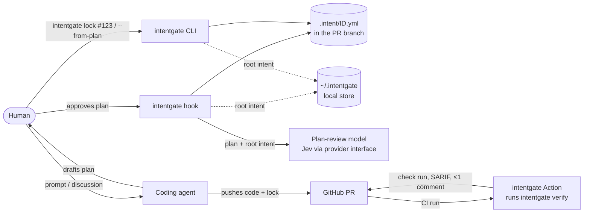
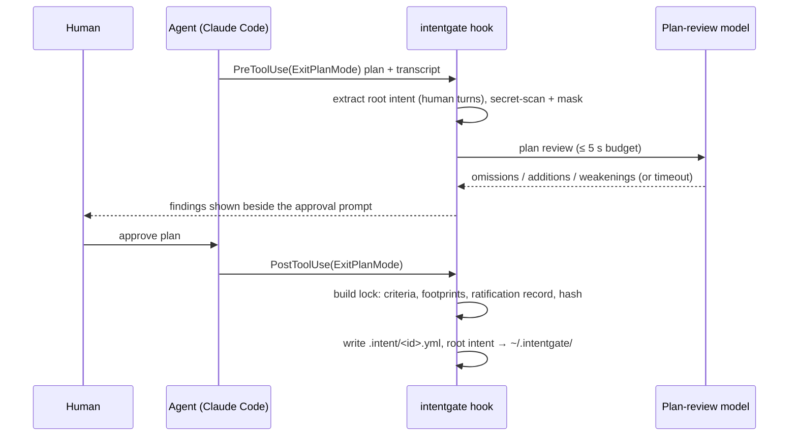
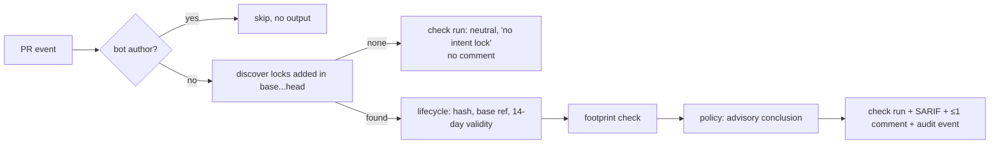

# IntentGate architecture (Phase 0)

**Status:** draft for review, 2026-11-18
**Scope:** Phase 0 only (v2 §7, cut by the adoption-first triage). It is advisory, so nothing here blocks a merge. Phase 1 (Jev verification, packets, question library, calibration) is deliberately not designed yet.
**Vocabulary:** `docs/glossary.md`. **Decisions:** `docs/adr/`.

Each file in this directory is a **design element** in req's sense. It declares the claims it satisfies with satisfaction links, and `req satisfy` reports when a claim's meaning moves against the design. This overview declares none.

| Element | Covers | Claims |
|---|---|---|
| [intent-lock.md](intent-lock.md) | Lock format, canonical form, hash, storage, validity | REQ-0006–0012, 0014, 0022 |
| [ratification.md](ratification.md) | The three ways a lock is created, confirmation, secret scan | REQ-0002–0005, 0013, 0015 |
| [plan-review.md](plan-review.md) | Plan vs prompt at ratification time | REQ-0016–0020 |
| [footprint-check.md](footprint-check.md) | The deterministic footprint check | REQ-0024–0031 |
| [pr-check.md](pr-check.md) | Lock discovery, lifecycle checks, check run, SARIF, comment | REQ-0021, 0023, 0032–0039 |
| [core-contracts.md](core-contracts.md) | Determinism, exit codes, JSON output | REQ-0040 |
| [audit-metrics.md](audit-metrics.md) | Audit events and the footprint-amendment rate | REQ-0041, 0042 |

---

## 1. Context



Three properties of this picture matter:

1. **The PR check never needs the root intent or a model.** Phase 0's PR-time work is the footprint check and the lock lifecycle checks, which are deterministic. The root intent stays on the ratifier's machine (REQ-0014), and the only model call in Phase 0 happens at ratification time.
2. **No server in Phase 0.** Locks live in git, the audit trail is a CI artifact plus a local log, and metrics are derived from git history. A hosted GitHub App is Phase 1.5 (ADR 0005).
3. **Agents are not treated as adversaries.** Following the triage, Phase 0 records how a lock was ratified but enforces nothing (ADR 0003).

## 2. Containers and code layout

One Go module, one binary (`intentgate`), plus an offline Python project. ADR 0001 explains the language choice.

```text
cmd/intentgate/            CLI entry: lock, amend, verify, hook, stats
internal/lock/             PURE  schema, validation, canonical form, hash, validity
internal/footprint/        PURE  glob matching, implicit footprints, test pairing, findings
internal/policy/           PURE  outcome → check conclusion and exit code
internal/report/           PURE  JSON (intentgate.verify/1), SARIF 2.1.0, check-run markdown
internal/planreview/       provider interface + Jev provider + "unavailable" fallback
internal/ratify/           confirmation UI, secret scan, local root-intent store
internal/hooks/claudecode/ adapter: Claude Code PreToolUse/PostToolUse on plan approval
internal/gitx/             adapter: changed files, commit times, via the git CLI
internal/forge/github/     adapter: check run, comment, PR metadata (Checks/Issues API)
action/                    composite GitHub Action that runs `intentgate verify`
schema/                    intentgate.lock.v1.json, intentgate.verify.v1.json (public contracts)
eval/                      Python (uv): Phase 1 labeling and calibration harness, never shipped
```

**The rule that carries the design:** packages marked PURE take values and return values. They do no I/O, read no clock and make no network calls. Every input that varies (lock files, changed paths, config, the evaluation time) is passed in by an adapter. This is what makes `intentgate verify` deterministic and replayable (REQ-0040), and it keeps the core testable with table tests, which become the `tests:` links that turn `req gate` green.

## 3. The two flows

### 3.1 Ratification (local, interactive)



The CLI paths (`intentgate lock #123`, `intentgate lock --from-plan plan.md`) follow the same steps, with an interactive terminal confirmation in place of the agent's approval prompt.

### 3.2 PR check (CI, deterministic)



## 4. Cross-cutting decisions

| Topic | Decision | Where |
|---|---|---|
| Language | Go product, Python offline evaluation | ADR 0001 |
| Lock storage | Committed in the PR branch under `.intent/`, root intent stored locally, hash only in the lock | ADR 0002 |
| Ratification | Method recorded (`hook`, `cli-confirm`, `issue`), nothing enforced in Phase 0 | ADR 0003 |
| req | Used for this project's requirements now; product integration later through req's CLI and JSON, never as a library | ADR 0004 |
| Distribution | CLI and a composite GitHub Action in Phase 0; GitHub App in Phase 1.5 | ADR 0005 |
| Exit codes | req's contract: 0 settled, 1 finding, 3 UNVERIFIABLE, 2 usage | core-contracts.md |
| Evaluation time | The head commit's committer time, never the wall clock | core-contracts.md |

## 5. Open questions for review

1. ~~REQ-0023 conflicts with ADR 0002.~~ Resolved 2026-11-18: REQ-0023 now uses the hash check (pr-check.md §3).
2. **The Claude Code hook mechanics** (PreToolUse for plan review, PostToolUse for the lock, review duration measured between the two) must be verified against the current Claude Code hook documentation before implementation. See ratification.md §2.
3. **Root intent for the rest of the team.** Storing it only on the ratifier's machine means reviewers can't read it in Phase 0. This is acceptable for advisory use; Phase 1.5's server store fixes it.
4. **Plan-review model.** Jev access and terms are a dependency for REQ-0016–0019. Without access, the plan review reports "unavailable" and ratification proceeds (REQ-0020), so this doesn't block anything else.
