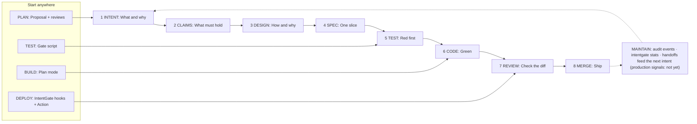
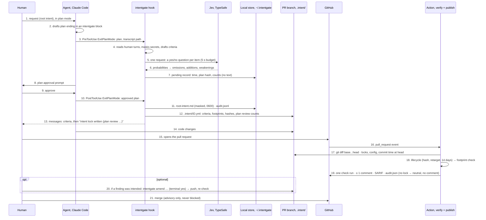

<!-- Generated by scripts/sdlc-map.py from docs/process/sdlc-map.yml. Do not edit this file:
     edit the YAML and run `python3 -I scripts/sdlc-map.py`. scripts/check.sh fails when they differ. -->

# IntentGate SDLC map

IntentGate · compared with the AI-native SDLC playbook

Two loops run here. The **build loop** is how this repository makes IntentGate (req, specs, workers, reviewers). The **product loop** is what IntentGate does for a team using it (lock, PR check, amend). The playbook describes one loop; we have both, and some words mean different things in each.

## 1 · Our stages, drawn like the playbook's

One row per kind: orange boxes are where work can start, dark boxes are the pipeline. A slice moves left to right; maintenance feeds the next intent.

| # | Stage | Question | Where |
|---|---|---|---|
| 1 | INTENT | What and why | proposal, reviews |
| 2 | CLAIMS | What must hold | claims/*.yml · req canon |
| 3 | DESIGN | How and why | docs/design · ADRs · req satisfy |
| 4 | SPEC | One slice | docs/specs/S-NN: claim ids + allowed paths |
| 5 | TEST | Red first | failing tests + tests: links |
| 6 | CODE | Green | worker in a worktree |
| 7 | REVIEW | Check the diff | path check · DeepSeek · PR check |
| 8 | MERGE | Ship | CI · req check · Baseline · human merge |

**↺ MAINTAIN** audit events · intentgate stats · handoffs feed the next intent (production signals: not yet)

**Same as the playbook**

- Every stage commits an artifact the next one reads: claim → design → spec → test → code → review → merge.
- Plan approval is the gate before code (the hook writes the lock there).
- Hooks are the deterministic layer; skills and prompts stay advisory.
- PR review checks the diff against the plan (footprint check).

**Different**

- Requirements are a *persistent* corpus (`claims/`) with addresses and a signed Baseline; the playbook's spec.md is per change.
- A second model family reviews every slice before the human sees it.
- No per-change `intent.md`: the build loop starts from a spec the orchestrator writes; the product keeps the root intent private.
- No production signal writes the next intent yet.

## 2 · Which artifact answers which question

The playbook's chain is `intent.md → spec.md → plan.md → diff → review findings`. Here is where each lands for us, in both loops.

| Playbook | Build loop (this repo) | Product loop (a team using IntentGate) | State |
|---|---|---|---|
| `intent.md` *what, why, constraints; product owner accepts* | `docs/intent-gate-proposal-v2.md` and the reviews: once, for the whole project. No per-slice intent file. | The root intent: the prompt, issue or pasted request. Masked, kept on the ratifier's machine; only its hash is committed. | gap |
| `spec.md` *requirements and design* | `claims/` (what must hold), `docs/design/` (how), `docs/adr/` (why). `docs/requirements.md` was the adoption source and is frozen. | Not IntentGate's job; the team's own docs. | overlap |
| `plan.md` *accepted in plan mode* | `docs/specs/S-NN-*.md`: claim ids, allowed paths, red-first tests. Committed before a worker starts. | The approved plan with its `intentgate` block, turned into `.intent/<id>.yml` (criteria + footprint + ratification). | covered |
| diff vs plan | Orchestrator runs `git diff base...branch --name-only` against the spec's allowed paths. | Footprint check in `intentgate verify`, with an `amend` command per finding. | covered |
| review findings | DeepSeek review, turned into a binding "Review 1 amendments" bullet in the spec. | One check run, at most one comment, SARIF. | covered |
| CI/CD | `scripts/check.sh`: gofmt, vet, staticcheck, tests, `req check`, Baseline verify; `req diff` on PRs. | The composite Action on `pull_request`. | covered |
| closing the loop | Handoffs, coverage explorer. | Audit events, `intentgate stats` (amendment rate, merged PRs and lock coverage). | partial |

**Overlaps and double meanings**

- **"intent"** means three things: the project proposal, a team's root intent, and the playbook's reviewed `intent.md`.
- **"spec"** means our slice spec (closer to the playbook's *plan.md*), the playbook's *spec.md* (closer to our claims + design), and req's `docs/spec.md` projection, which we don't generate.
- **`requirements.md` vs `claims/`**: same content, but only the claims are live. The old file now carries an archive header pointing to `claims/`.
- **Slice spec vs intent lock**: AGENTS.md already calls a spec "this project's intent lock, written by hand". A slice spec now ends with an `intentgate` block, so a human may turn it into a real `.intent/` lock.

**What would make the flow clear**

- Done in S-15: `docs/requirements.md` is marked as archived (header pointing to `claims/`).
- Done in S-15: a glossary row per artifact: intent, claim, design element, ADR, slice spec, plan, intent lock, Baseline.
- Dogfood: each slice spec ends with an `intentgate` block (claims as criteria, allowed paths as footprint). Since S-17 this repo has run `intentgate init`: the orchestrator presents the spec as a plan, and approving it writes the lock. Where the hook can't run, `scripts/lock-slice.sh <S-NN>` runs `lock --from-plan` for the spec. Then the PR check does the orchestrator's path check. Locking is the human's act.
- Phase 1 ADR: a committed, product-owner-accepted `intent.md` as a lock source.

## 3 · End-to-end lifecycle and data flow

The product loop for one change, from a prompt to a merged PR, as it runs after S-14. The CLI paths (`lock --from-plan`, `lock --issue`) replace the two hook steps with a terminal `yes`.

What is committed: the lock (criteria, footprints, hashes, counts). What stays local: the root intent text and the pending record. What leaves the machine: masked text to Jev during ratification; the lock and check results to GitHub.
